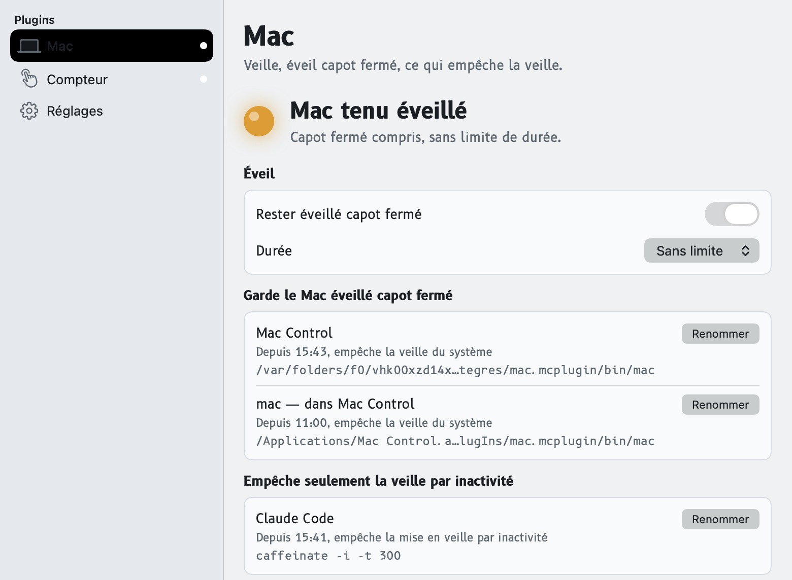
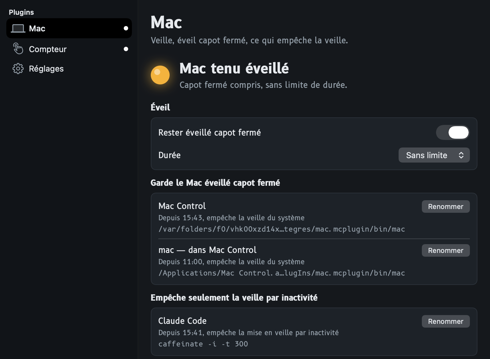
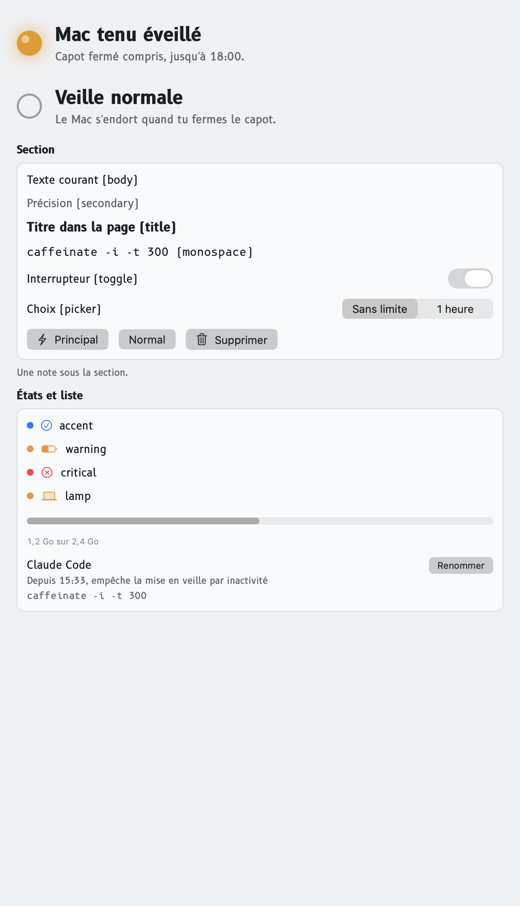
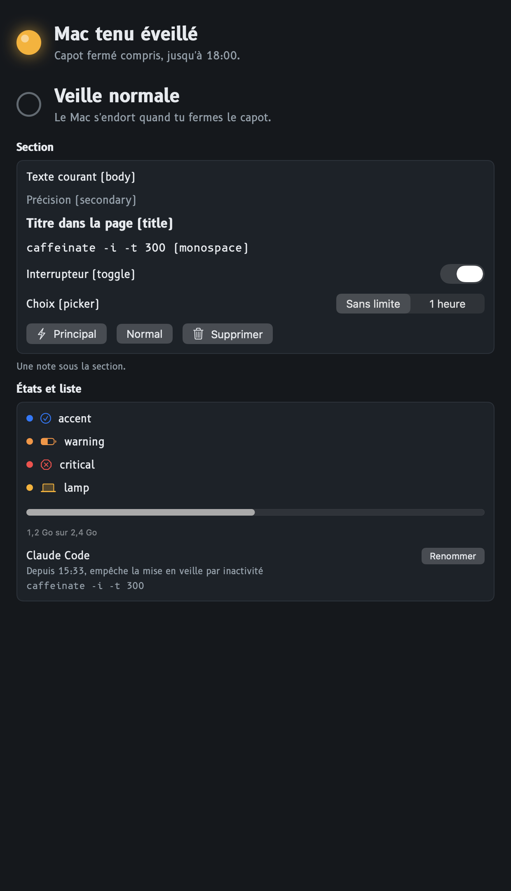
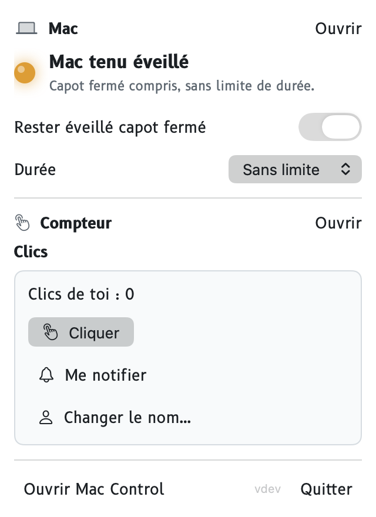

# Le style de Mac Control

Mac Control pilote le Mac : il le garde éveillé, montre ce qui l'empêche de dormir, fait tourner des plugins. Son
style vient de là : **un tableau de bord qu'on lit d'un coup d'œil**, comme un écran de cockpit. Les contrôles restent
ceux de macOS (interrupteurs, menus, feuilles) ; Mac Control pose dessus sa police, ses teintes et un seul signe
fort, le voyant.

Ce que ce document fixe s'applique à la régie (la fenêtre, le panneau, les Réglages) et à tout ce qu'elle dessine
pour les plugins. Un plugin ne choisit ni police ni couleur : il choisit un rôle (§ 7 bis du
[contrat](contrat/1.3.md)), et Mac Control le dessine ainsi.

| Clair | Sombre |
|---|---|
|  |  |

## 1. Les règles

1. **Un seul signe fort : le voyant ambre.** Il veut dire « un état est tenu allumé » (le Mac gardé éveillé), et rien
   d'autre. Aucun bouton, aucun titre, aucune alerte n'est ambre.
2. **Ce qui se clique prend la couleur d'accent de macOS**, celle que l'utilisateur a choisie. Le reste n'est pas
   coloré.
3. **Un seul bouton principal par écran** (`borderedProminent`).
4. **Ni blanc pur, ni crème, ni gris neutre** : des gris froids légèrement bleutés en clair, un graphite bleuté en
   sombre.
5. **B612 partout où Mac Control écrit** ; B612 Mono seulement pour ce qui se tape tel quel (commande, chemin). Les
   contrôles natifs gardent leur rendu système.
6. **Des mots, pas des commandes** : un titre dit ce que l'utilisateur connaît (« Claude Code »), la commande va dessous
   en petit, sur une ligne, coupée au milieu.
7. **Une heure dit ce qu'elle mesure** : « depuis 11:00 », « jusqu'à 18:00 », « Plugin en marche depuis 15:34:54 ».
8. **Le même nom n'apparaît qu'une fois** par écran.

## 2. La police : B612

B612 a été dessinée pour Airbus (2012, Intactile Design et l'ENAC) pour les écrans de cockpit : des formes ouvertes
qui se lisent vite, des chiffres qu'on ne confond pas. Elle va à un outil qui pilote une machine, et elle n'est pas
une police « tendance ». Licence **SIL Open Font License 1.1** (texte dans `Support/Fonts/OFL.txt`) : libre
d'embarquer dans l'app.

| Fichier | Nom PostScript | Rôle |
|---|---|---|
| `B612-Regular.ttf` | `B612-Regular` | tout le texte |
| `B612-Bold.ttf` | `B612-Bold` | titres, état du voyant, titres de section |
| `B612Mono-Regular.ttf` | `B612Mono-Regular` | commandes, chemins, `style: monospace` |

Les fichiers sont dans `Support/Fonts/`, copiés par `scripts/build-app.sh` dans `Contents/Resources/Fonts`, et
enregistrés au lancement (`Typeface.register()`). Hors de l'app, `MAC_CONTROL_FONTS=<dossier>` les désigne.

**Échelle** (`Typography.size`, en points ; B612 est large, d'où un cran sous les tailles macOS) :

| Style | Taille | Usage |
|---|---|---|
| `largeTitle` | 26 | nom du plugin en tête de son onglet |
| `title` | 22 | état du voyant dans la fenêtre |
| `title2` | 18 | titre de feuille (acceptation) |
| `title3` | 15 | état du voyant dans le panneau, `style: title` |
| `body` | 12,5 | texte courant |
| `headline` | 13 | titres de section (gras) |
| `footnote` | 11 | sous-titres de ligne, pied de l'onglet |
| `caption` | 10,5 | commandes (`detail`), notes |

En code : `.font(.b612(.body))`, `.font(.b612(.title, bold: true))`, `.font(.b612Mono(.caption))`.

## 3. Les teintes

Chaque jeton a une valeur en clair et une en sombre ; il suit l'apparence de macOS tout seul (`Palette`, dans
`Sources/MacControl/Theme.swift`).

| Jeton | Clair | Sombre | Usage |
|---|---|---|---|
| `canvas` | `#EEF1F3` | `#14181C` | fond de la fenêtre, des Réglages, des feuilles |
| `surface` | `#F8FAFB` | `#1C2229` | boîte d'une section, lignes des Réglages |
| `sidebar` | `#E4E9ED` | `#101418` | liste de gauche |
| `ink` | `#1A1F24` | `#E6EAEE` | texte |
| `inkSoft` | `#5B6670` | `#93A0AB` | texte secondaire, icônes |
| `hairline` | `#D5DCE2` | `#2A323B` | contour des boîtes, séparateurs |
| `lamp` | `#E89A00` | `#FFB000` | **le voyant seulement** (et la teinte `lamp` du contrat) |
| `alert` | `#C2402F` | `#FF7A68` | ce qui doit être lu avant d'accepter (feuille d'acceptation) |
| accent | système | système | tout ce qui se clique |

Les teintes du contrat (`tint`) : `neutral` → `inkSoft`, `accent` → accent système, `warning` → orange système,
`critical` → rouge système, `lamp` → `lamp`.

## 4. Les composants réutilisables

Dans `Sources/MacControl/Theme.swift` et `Sources/MacControl/Rendering/` ; à reprendre tels quels plutôt que d'en
refaire un.

| Composant | Ce qu'il est | Où |
|---|---|---|
| `Lamp(lit:size:)` | le voyant : ambre avec son halo allumé, anneau vide éteint | `Theme.swift` |
| `SurfaceBox()` | la boîte d'une section : `surface` + contour `hairline`, rayon 8 | `Theme.swift` |
| `IndicatorNode` | le voyant et son état en grand (élément `indicator` du contrat) ; plus petit dans le panneau | `Rendering/Components.swift` |
| `SectionNode` | titre B612 gras, boîte `SurfaceBox`, note dessous | `Rendering/Components.swift` |
| `ListNode` / ligne | titre, sous-titre, `detail` en B612 Mono coupé au milieu, actions en vrais boutons | `Rendering/Components.swift` |
| `StatusLine` | une pastille, un symbole, une phrase, dans la teinte de l'état | `Rendering/Components.swift` |
| `DevelopmentBadge` | « dév », pour un plugin du dossier de développement | `PluginDetail.swift` |
| `ConfirmableButton` | un bouton qui demande confirmation s'il est destructif | `Rendering/Inputs.swift` |

La planche de tous les éléments du contrat, tels que Mac Control les dessine :

| Clair | Sombre |
|---|---|
|  |  |

(Sur ces captures, faites hors écran, les boutons principaux et l'interrupteur allumé sortent gris : dans l'app, ils
prennent la couleur d'accent.)

## 5. Les icônes et le voyant de la barre des menus

- **Les icônes** sont des **SF Symbols** (la bibliothèque d'icônes de macOS ; l'app gratuite « SF Symbols » d'Apple
  les montre avec leur nom). Encre `inkSoft`, au trait dans la liste de gauche. Celles de Mac Control :
  `laptopcomputer` (Mac), `hand.tap` (Compteur), `gearshape` (Réglages), `switch.2` (Mac Control au repos dans la
  barre des menus), `battery.50percent` (sur batterie), `exclamationmark.triangle.fill` (alerte).
- **La barre des menus** montre le symbole du plugin dont l'indicateur l'emporte, ou `switch.2`. Avec la teinte
  `lamp`, le symbole garde la couleur de la barre et **un voyant ambre s'allume dans son coin** : on voit d'un coup
  d'œil que le Mac est tenu éveillé.
- **Pas de logo dessiné** : Mac Control n'a pas d'icône d'app (il vit dans la barre des menus) ; un plugin ne livre
  pas d'image, il nomme un SF Symbol.

## 6. Le panneau sous l'icône

Le voyant en tête, en petit ; puis les contrôles du plugin. Le nom du plugin est en tête de sa section : le plugin
ne le répète pas dans son arbre.

## 7. Refaire les captures

Les images de ce document sont rendues hors écran à partir des vraies vues (un banc de test jetable, jamais commité,
qui rend `NodeView`, `ControlView` et `PanelView` dans une `NSHostingView`) : Mac Control installé n'est ni quitté ni
relancé. Les refaire après tout changement de style.
